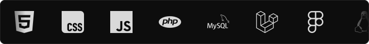
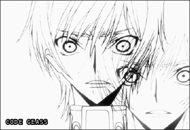
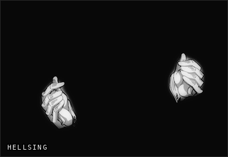
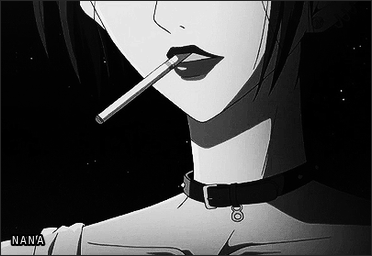
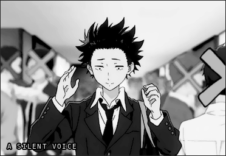

<!--
  eliutot/eliutot · profile README
  repo must be public, named exactly "eliutot", README.md on the default branch.

  assets/profile.svg is generated: scripts/make_svg.py reads art_small.txt +
  scripts/stats.json. the panel below is generated too: build.py downsamples
  art.txt and rebuilds it at 80 columns. edit the sources, re-run, don't nudge
  spaces by hand or the columns drift.

  the numbers in the svg are refreshed daily by .github/workflows/profile.yml.
  a committed svg can never be live — GitHub caches it through camo until the
  file itself changes.
-->



<details>
<summary><code>$ neofetch</code></summary>

```
⠈⠉⠛⠋⠀⢸⠀⣀⠈⠙⠿⣿⣿⣿⣿⡿⠋⢉⢻⣿⣿⣿⠀⣮⣝⠨⣵⣆⠀⣇⠀⠰⠀⠀⠀⢰
⠀⠀⢀⠀⠀⣬⠀⡛⠀⣀⠦⣀⣙⡿⠋⠔⠀⣡⡾⠋⠼⠛⠀⢻⣿⡇⣦⣝⠀⢴⠈⠀⠀⠀⠀⢸
⠀⠀⠸⠀⠀⢙⠀⠷⠀⣶⣍⡊⠯⣤⣖⣀⠘⢉⠀⠀⡾⠂⠀⣉⡰⡧⠙⠛⠀⢠⡀⠀⠀⠀⢸⢻
⡄⠀⠀⠀⠀⢸⠀⠿⠆⠲⠶⠶⠤⠌⣛⠿⣷⣷⣶⣂⡄⢰⡇⣿⣿⠄⠘⠀⠃⠸⡇⡀⠀⠀⠈⠐
⠓⡇⠀⠀⠀⠈⠀⠀⠀⠀⠀⡀⠀⠀⠐⣛⢆⢉⣛⠻⢷⣾⡇⠉⢋⣴⠏⡰⠀⠀⠁⠇⠀⠶⠀⠀   angelica@github
⠀⢠⠀⠀⠀⠀⠀⠠⣄⠀⡀⠀⠐⢐⣶⣿⣾⣿⣿⣿⣶⣮⡅⣙⡻⠧⠄⢀⡁⠀⠀⠀⠀⠀⠀⠀   ---------------
⠀⡩⠀⠀⠀⠀⣷⢠⣀⡀⢀⣠⣴⣾⣿⣿⣿⣿⣿⣿⣿⣿⠃⣿⣿⣿⣷⢠⡅⣰⠀⠀⠀⠀⠀⠀   OS:       Linux Mint · full-stack dev
⠋⠀⠀⢀⠀⠀⢸⠈⣿⣿⡌⣿⣿⣿⣿⣿⣿⣿⣿⣿⣿⣿⠀⣿⣿⣿⣿⠸⠇⡿⣸⠀⠀⠀⠀⠀   Host:     Aiken, SC ⇄ Kuwait
⠀⠀⠐⠈⠀⠀⡀⠃⢸⣿⣧⢻⣿⣿⣿⣿⣿⣏⠻⣻⣟⣿⢀⣿⣿⣿⣿⡇⢰⠇⠏⠀⡄⠀⠀⠀   Kernel:   ICSA Kuwait · program 3 of 4
⠠⠄⠀⠀⠀⠀⠀⠀⠈⢿⣿⣎⢿⣿⣿⣿⣿⣿⣿⠿⢿⠟⠸⠿⠿⣿⣿⡇⡸⣀⠀⠀⠀⠀⠀⢀   Uptime:   building since middle school
⠀⠀⠀⢀⣀⠀⠀⠀⠀⠀⠙⠿⡸⣿⣿⣿⣟⠛⠉⠀⢒⡁⣵⣾⣿⣿⣿⠃⢀⣿⡆⠀⣀⠀⠀⢸   Packages: HTML CSS JS PHP MySQL Laravel
⠀⠀⣰⣿⣿⡇⠀⠀⠀⠀⠀⠀⠀⠹⢿⣿⠏⠀⢀⣨⣭⢠⣵⣾⣿⣿⠋⡀⣾⣿⠀⠀⠀⠀⠀⣾   Shell:    bash · zsh · powershell
⠠⢀⣿⣿⣿⡇⠀⠀⠀⠀⠀⠀⠀⠀⠀⠆⠀⠠⢿⣿⡿⣸⣿⣿⠟⣱⢠⣷⣿⠏⠀⡀⠀⠀⠀⣿   DE:       Figma · Adobe CC
⣼⣿⣿⣿⣿⡇⠀⠀⠀⠀⠀⠀⠈⠀⠀⠀⢠⣾⣷⣭⠙⠿⢟⣥⣾⣣⣿⣿⠃⠀⠀⡁⠀⠀⠀⢿   CPU:      human (1) @ 1.0 caffeine
⣿⣿⣿⣿⣿⡇⠀⠀⠀⠀⠀⠀⣴⠀⠈⠃⠾⣿⣿⣿⣾⣿⣿⣿⣿⣿⠟⠁⠀⠀⣰⡇⠀⠀⠀⠸   Memory:   NANA · Code Geass · Junji Ito
⣿⣿⣿⣿⣿⡇⠀⠀⠀⠀⠀⢸⣿⣄⣈⠀⠀⠈⠉⠛⠛⠿⠛⠋⠉⠁⠀⠀⢀⣼⣿⠃⠀⠀⠀⠀   Locale:   en_US · nu-metal + post-punk
⢿⣿⣿⣿⡿⠁⠀⠀⠀⠀⠀⢺⣿⣿⣿⣿⣦⣄⠀⠀⠀⠀⠀⠀⡀⠀⠀⠀⠉⠻⣿⠀⠀⠀⠀⠀   Status:   open to internships + freelance
⠒⠢⢄⠈⠀⠀⠀⠀⠀⠀⠀⣀⠙⢿⣿⣿⣿⣿⣷⣦⣀⣀⣀⣴⣷⣶⣄⠀⠀⠀⠘⠀⠀⠀⠀⠀   Contact:  aj-dornton@proton.me
⠀⠀⠀⠑⢄⠀⠀⠂⠀⠀⠀⣿⣷⣦⣝⡿⡿⣿⣿⣿⣿⣿⣿⣿⣿⣿⣿⠷⢄⣀⠃⠀⠀⠀⠀⠀
⠀⢻⣷⣄⠈⠀⠀⠀⠀⠀⠀⣿⣿⣿⣿⣿⣿⣶⣶⡍⠻⣿⣿⣿⠟⢋⣴⡿⢻⡿⠀⠀⠀⠀⠀⠀
⠀⠈⡿⠋⠀⠀⠀⠀⠀⠀⠀⢻⣿⣿⣿⣿⣷⣭⣙⣿⣦⣤⣿⣧⣴⣿⣯⣾⣿⡇⠀⠀⠀⠂⠀⠀
⡷⠀⠀⠀⠀⣀⠀⠀⠀⠀⠀⠘⣿⣿⣿⣿⣿⣿⣿⣿⣿⣿⣿⣿⣿⣿⣿⣿⣿⠀⠀⠀⠀⠀⠁⠄
```

      

</details>

[](mailto:aj-dornton@proton.me)
[](https://eliutot.github.io/)
[](https://www.behance.net/angelicadornton)
[](https://www.figma.com/@dornton)
[](https://passportdex.com/angelicaa)

---

## about

full-stack web developer and graphic designer, in that order on a good day and the other order on a deadline.

i'm in my third year of the ICSA program, splitting the year between Aiken, SC and Kuwait. most of what i build is PHP and MySQL behind Laravel, with HTML, CSS and JS in front of it — and a Figma file behind all of it, because the layout problem is usually solved there and not in the browser.

i care about the part where a design stops being a frame and starts being something that loads fast on a bad connection.

open to internships and freelance work. i'd rather see something half-formed than something polished that arrives too late.

## stack



<sub>html · css · javascript · php · sql · laravel · mysql · figma · adobe cc · linux mint</sub>

## selected work

- **[portfolio](https://dornton.vercel.app)** — my own site, where the design work and the code actually meet.
- **[spotify-redesign](https://github.com/eliutot/spotify-redesign)** — a redesign of spotify's interface, built in plain html and css.
- **[ayusbday](https://jeljolie.github.io/ayusbday/)** — a birthday site, described by its own repo as *pain in da arse yet so worth it*.

## off the clock

NANA, Code Geass, Hellsing, A Silent Voice. nu-metal and post-punk on repeat. the mood of all of it tends to leak into the design work.

 <br>
 

writing about a project? tell me what you're building and when you need it :D

<sub>signed: a.dornton</sub>
